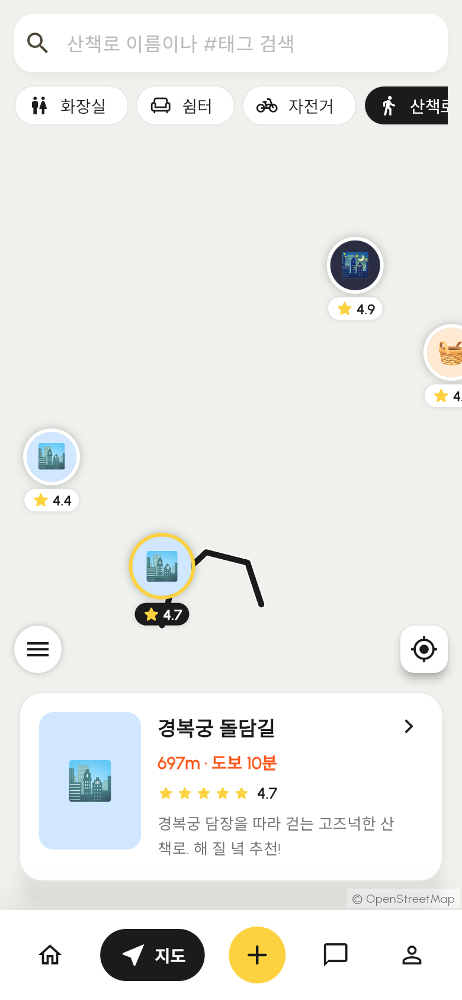
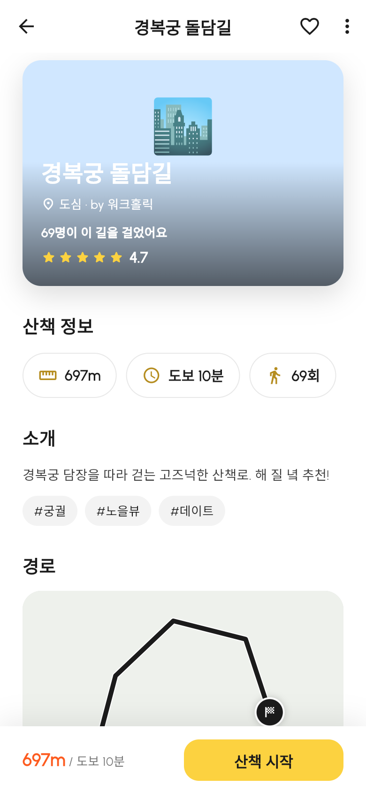
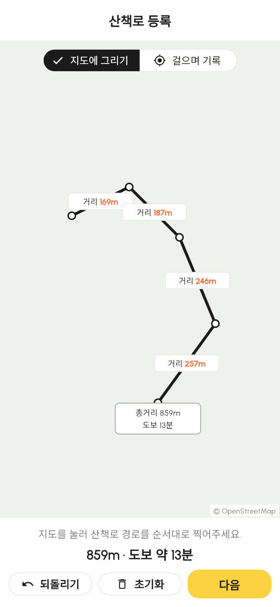
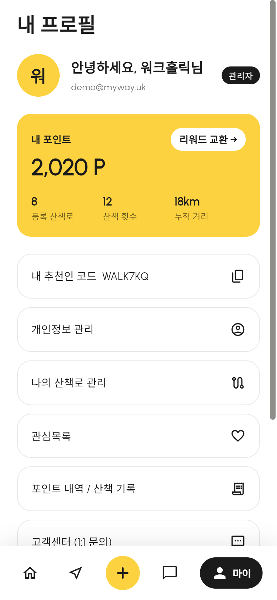

# MyWay — 산책 커뮤니티 & 보상형 플랫폼

> ' 산책이 일상으로 ' — 나만의 산책로를 지도에 등록·공유하고, 걸으면 포인트를 받아 지역 제휴 매장에서 쓰는 앱

Team **WalkHolic** 기획서(MyWay)를 기반으로 구현한 **Flutter + Firebase** 풀스택 앱입니다.
Android / iOS / Web 을 하나의 코드로 지원합니다.

| 계층 | 기술 |
|---|---|
| 프론트엔드 | Flutter 3.50 (Dart 3.14), go_router, flutter_map(OpenStreetMap), geolocator |
| 인증 | Firebase Authentication (이메일+이메일 인증, Google) |
| DB | Cloud Firestore |
| 파일 | Cloud Storage for Firebase |
| 백엔드 | Cloud Functions for Firebase v2 (TypeScript, 서울 리전 `asia-northeast3`) |
| 보안 | Firestore/Storage 보안 규칙, App Check, 커스텀 클레임(관리자), 서버 검증 |
| 호스팅 | Firebase Hosting (웹, 보안 헤더 포함) |

---

## 화면

UI는 Figma 커뮤니티 디자인 **"Traveling Mobile App" (Pickolab Studio)** 의 스타일 가이드(컬러·타이포·컴포넌트)를 기반으로 MyWay 기능에 맞게 적용했습니다.

| 로그인 | 홈 | 지도 | 산책로 상세 | 산책로 등록 |
|---|---|---|---|---|
|  |  |  |  |  |
| **검색** | **커뮤니티** | **마이페이지** | **리워드** | |
|  |  |  |  | |

> 로컬 에뮬레이터 + 샘플 데이터로 캡처한 웹 버전 화면입니다. 캡처 환경에서 지도 타일 서버 접속이 막혀 지도 배경은 회색으로 보입니다. 샘플 산책로에는 사진이 없어 카테고리 이모지 플레이스홀더가 표시되며, 사용자가 사진을 올리면 그 사진이 표시됩니다.

### 디자인 토큰 (`lib/core/theme.dart`)

| 토큰 | 값 | 용도 |
|---|---|---|
| Brand/Yellow/500 | `#FCD240` | 메인 CTA 버튼, 포인트 카드, 별점 |
| Primary/Black/500 | `#1B1B1B` | 텍스트, 선택된 탭/칩 |
| Black/400 · 300 · 200 · 100 | `#767676` `#BABABA` `#E8E8E8` `#F3F3F3` | 보조 텍스트 · placeholder · 테두리 · 검색창 배경 |
| Error/500 | `#FD5B1F` | 하트(관심), 거리 강조 |
| 폰트 | Urbanist + Noto Sans KR | |
| 모서리 | 12 / 16 / 20 | 썸네일 / 입력·버튼 / 카드 |

---

## 1. 기능 (기획서 → 구현 매핑)

| 기획서 | 구현 화면 / 기능 |
|---|---|
| **홈** — 인사, 검색, 카테고리, 인기/신규 산책로 | `lib/screens/home/home_screen.dart` |
| **지도** — 사진+평점 마커, 화장실/쉼터/자전거/산책로/관심목록 필터, 검색 | `lib/screens/map/map_screen.dart` |
| **산책로 등록** — 지도에서 경로 지정, 구간별 거리(`거리 375m`), 총거리·도보시간 | `trail_record_screen.dart` (지도에 그리기 / GPS로 걸으며 기록) → `trail_form_screen.dart` (사진·소개·#태그·카테고리: 반려견/야경 맛집 등) |
| 산책로 등록 시작/종료, 산책로 목록 메뉴 | 지도 좌하단 메뉴, `trail_list_screen.dart` (최신/평점/인기순, 카테고리) |
| 산책로 상세 | 경로 지도, 리뷰·별점(1인 1리뷰), 관심목록(♥), 수정/삭제 |
| **커뮤니티** — 공지사항/자유게시판/Q&A, 검색, 글쓰기, 조회수, HOT 게시물 | `community_screen.dart`, `post_detail_screen.dart`(댓글), `post_form_screen.dart` (공지는 관리자만) |
| **마이페이지** — 개인정보 관리 / 산책로 관리(수정·삭제) / 고객센터 / 산책로 등록 바로가기 | `mypage_screen.dart`, `profile_screen.dart`, `my_trails_screen.dart`, `inquiry_screens.dart` |
| **보상형 플랫폼** — 첫 가입 포인트, 추천인 이벤트 | 가입 500P, 추천인 코드 입력 시 양쪽 300P (`initProfile` 함수) |
| 걷기 보상 | `walk_screen.dart` 산책로 따라 걷기 → 서버가 경로 검증 후 포인트 지급 (`completeWalk`) |
| 지역 업체 제휴 | 포인트로 제휴 매장 쿠폰 교환 (`rewards_screen.dart`, `redeemReward`) |
| 산책로 등록 보상 | 등록 시 50P (하루 3회까지) |
| 관리자 | 공지 작성, 모든 글/산책로/리뷰 삭제, 1:1 문의 답변 (`admin_inquiries_screen.dart`) |

### 포인트 정책 (`functions/src/rules.ts`)

| 항목 | 포인트 | 제한 |
|---|---|---|
| 첫 가입 | 500P | 1회 |
| 추천인 코드 입력 (신규/추천인 각각) | 300P | 가입 시 1회 |
| 산책로 등록 | 50P | 하루 3회 |
| 산책 완료 | 10P + 1km당 10P (최대 100P) | 하루 5회, 같은 산책로 하루 1회 |

---

## 2. 프로젝트 구조

```
lib/
  main.dart               Firebase 초기화, App Check, 에뮬레이터 연결
  app.dart                라우팅(go_router) + 인증 가드
  core/                   테마, 거리 계산, 입력 검증, 오류 메시지
  models/                 Trail, Post, AppUser, Facility ...
  services/               Firestore/Storage/Functions 접근 계층
  screens/                auth / map / trail / search / community / mypage / admin
  widgets/                공통 위젯, 지도 타일
functions/                Cloud Functions (TypeScript)
  src/index.ts            회원·산책·리워드·조회수·관리자 함수 + 집계 트리거
  src/rules.ts            포인트 정책 / 산책 검증 순수 로직 (단위 테스트)
  src/scripts/            seed(편의시설·리워드), grantAdmin(최초 관리자)
security-tests/           보안 규칙 + Functions 통합 테스트 (에뮬레이터)
firestore.rules           Firestore 보안 규칙
storage.rules             Storage 보안 규칙
firestore.indexes.json    복합 인덱스
firebase.json             배포/에뮬레이터/호스팅(보안 헤더) 설정
```

### Firestore 데이터 모델

```
users/{uid}                 nickname, email, points*, referralCode*, trailCount*, walkCount* ...
  ├ favorites/{trailId}     관심목록
  ├ pointLogs/{id}*         포인트 내역
  ├ walks/{id}*             산책 기록 (검증 결과 포함)
  ├ coupons/{id}*           교환한 쿠폰
  └ dailyStats/{yyyy-MM-dd}* 일일 보상 한도 집계
trails/{id}                 ownerId, title, description, tags[], category, path[GeoPoint],
  │                         distanceM, durationMin, photoUrl, ratingAvg*, ratingCount*, ...
  └ reviews/{uid}           rating(1~5), text  ← 문서 ID=uid 로 1인 1리뷰
posts/{id}                  board(notice|free|qna), title, content, viewCount*, commentCount*
  ├ comments/{id}
  └ viewers/{uid}*          조회수 중복 방지
facilities/{id}             type(toilet|shelter|bike), name, location   (관리자 등록)
rewards/{id}                title, partnerName, cost, stock, active      (관리자 등록)
inquiries/{id}              uid, title, content, status, answer          (답변은 관리자)
nicknames/{n}*, referralCodes/{code}*, processedEvents/{id}*            서버 전용 인덱스
```
`*` = Cloud Functions(Admin SDK)만 쓰기 가능. 클라이언트 수정은 보안 규칙이 거부합니다.

---

## 3. 보안 설계

1. **기본 거부** — 규칙에 명시되지 않은 모든 경로는 `allow read, write: if false`.
2. **위변조 방지 값은 서버에서만** — 포인트, 평점 평균, 조회수, 댓글/관심 수, 추천 코드, 산책 기록은 Cloud Functions 만 기록. 클라이언트가 `points: 999999` 또는 `increment()` 를 보내도 거부됩니다.
3. **필드 화이트리스트 + 타입/길이 검증** — 생성 시 `keys().hasOnly([...])`, 수정 시 `diff().affectedKeys().hasOnly([...])` 로 허용 필드만 변경. 제목/본문/태그 길이, 카테고리 enum, 경로 꼭짓점 수(≤2000), 평점 범위(1~5) 검증.
4. **사칭 방지** — `ownerId/authorId == auth.uid`, `authorName == 내 프로필 닉네임`, `createdAt == request.time`.
5. **이메일 인증 필수** — 이메일 가입자는 인증 전에는 글/산책로/리뷰 작성 불가 (구글 로그인은 공급자 인증).
6. **역할 기반 권한** — 관리자는 Firebase Auth 커스텀 클레임 `admin: true`. 공지 작성·문의 답변·콘텐츠 삭제·편의시설/리워드 관리.
7. **부정 적립 방지 (`completeWalk`)** — 서버가 GPS 경로를 검증: 평균 속도 ≤ 9km/h, 산책로 꼭짓점의 70% 이상을 50m 이내로 통과, 거리 ≥ 산책로의 60%, 시간 범위 검증, 일일 한도, 동일 산책로 1일 1회. 모든 지급은 트랜잭션 + 포인트 내역 기록.
8. **트랜잭션 / 멱등성** — 가입 보너스·추천인·리워드 교환(재고·포인트 동시 차감)은 트랜잭션. 트리거는 `event.id` 로 중복 실행 방지.
9. **App Check** — 정식 앱(Play Integrity / App Attest / reCAPTCHA v3)에서 온 요청만 Callable 함수 허용 (`functions/.env` 의 `ENFORCE_APP_CHECK=true`). Firebase 콘솔에서 Firestore/Storage 에도 App Check 강제 적용을 권장합니다.
10. **Storage** — 본인 폴더(`users/{uid}/trails|profile/`)에만, 이미지 MIME(jpeg/png/webp/heic), 5MB 미만, 안전한 파일명만 업로드.
11. **개인정보** — 다른 사용자의 프로필 문서는 읽을 수 없음(닉네임은 게시물에 비정규화). 회원 탈퇴 시 개인 데이터·사진·산책로 삭제, 게시글은 "탈퇴한 회원"으로 익명화. 비밀번호 찾기는 계정 존재 여부를 노출하지 않음.
12. **입력 검증 이중화** — 클라이언트(`core/validators.dart`)는 UX용, 실제 강제는 규칙/함수.
13. **웹 보안 헤더** — HSTS, X-Frame-Options, nosniff, Referrer-Policy, Permissions-Policy (`firebase.json`).
14. **Android** — `allowBackup=false`, cleartext(HTTP) 통신 차단.

---

## 4. 시작하기

### 사전 준비
- Flutter 3.50+ / Node.js 22 / Java 21 (에뮬레이터용)
- `npm i -g firebase-tools` · `dart pub global activate flutterfire_cli`

### 4-1. 로컬 에뮬레이터로 바로 실행 (Firebase 프로젝트 없이)

```bash
flutter pub get
cd functions && npm install && npm run build && cd ..

# 터미널 1: 에뮬레이터 (Auth/Firestore/Functions/Storage)
firebase emulators:start --project demo-myway

# 터미널 2: 샘플 편의시설·리워드 등록
cd functions && FIRESTORE_EMULATOR_HOST=127.0.0.1:8080 GCLOUD_PROJECT=demo-myway node lib/scripts/seed.js

# 터미널 3: 앱 실행 (웹/에뮬레이터)
flutter run -d chrome --dart-define=USE_EMULATOR=true
```
에뮬레이터에서는 `functions/.env.local` 로 App Check 강제가 꺼집니다. 이메일 인증 링크는 에뮬레이터 UI(http://localhost:4000 → Authentication) 또는 터미널 로그에서 확인하세요.

### 4-2. 실제 Firebase 프로젝트에 배포

1. [Firebase 콘솔](https://console.firebase.google.com)에서 프로젝트 생성 (Blaze 요금제 — Functions 필요)
2. Authentication → 로그인 방법: **이메일/비밀번호**, **Google** 사용 설정
3. Firestore(서울 `asia-northeast3`), Storage 생성
4. 앱 연결 (`lib/firebase_options.dart` 자동 생성):
   ```bash
   flutterfire configure --project=<프로젝트ID>
   ```
   `.firebaserc` 의 `your-firebase-project-id` 도 실제 ID로 교체
5. App Check 등록: Android(Play Integrity), iOS(App Attest), Web(reCAPTCHA v3 사이트 키)
6. 배포:
   ```bash
   firebase deploy --only firestore,storage,functions
   flutter build web --release --dart-define=RECAPTCHA_SITE_KEY=<사이트키>
   firebase deploy --only hosting
   ```
7. 샘플 데이터 & 최초 관리자 (서비스 계정 키 필요, 키는 절대 커밋 금지):
   ```bash
   cd functions
   GOOGLE_APPLICATION_CREDENTIALS=../sa.json npm run seed
   GOOGLE_APPLICATION_CREDENTIALS=../sa.json npm run grant-admin -- admin@example.com
   ```
8. iOS: `ios/Podfile` 의 `platform :ios` 를 `15.0` 이상으로 설정 (Firebase 요구사항)

> 디버그 빌드에서는 App Check 디버그 공급자를 사용합니다. 실행 로그에 출력되는 디버그 토큰을 Firebase 콘솔 → App Check → 디버그 토큰 관리에 등록하세요.

---

## 5. 테스트

```bash
flutter analyze && flutter test        # 앱 정적 분석 + 단위 테스트
cd functions && npm test               # 포인트 정책 / 산책 검증 단위 테스트
cd security-tests && npm install && npm test
                                       # 에뮬레이터에서 보안 규칙 + Functions 통합 테스트 (43개)
```

보안 테스트 예: 포인트 직접 수정 거부, 평점 조작 거부, 타인 명의 등록/수정 거부, 공지사항 권한, 조회수 조작 거부,
Storage 타인 폴더·비이미지·5MB 초과 업로드 거부, 가입/추천인 보너스, 차량 속도 산책 미인정, 재고 소진, 조회수 1인 1회.

---

## 6. 운영 시 참고

- **지도 타일**: 기본은 OpenStreetMap(무료, 키 불필요). 트래픽이 커지면 OSM 타일 정책에 따라 상용 타일(Mapbox, MapTiler 등) 또는 카카오/네이버 지도로 교체하세요 (`lib/widgets/map_tiles.dart`).
- **검색**: Firestore는 전문 검색을 지원하지 않아 제목 접두어 + 태그 일치로 검색합니다. 규모가 커지면 Algolia/Typesense 확장을 권장합니다.
- **지도 범위 쿼리**: 현재 최신 300개 산책로를 불러옵니다. 데이터가 많아지면 geohash 기반 범위 쿼리로 확장하세요.
- **광고/데이터 마케팅(비즈니스 모델)**: 인앱 광고(AdMob)·분석(Google Analytics for Firebase)은 개인정보 동의 절차와 함께 추가하세요.
